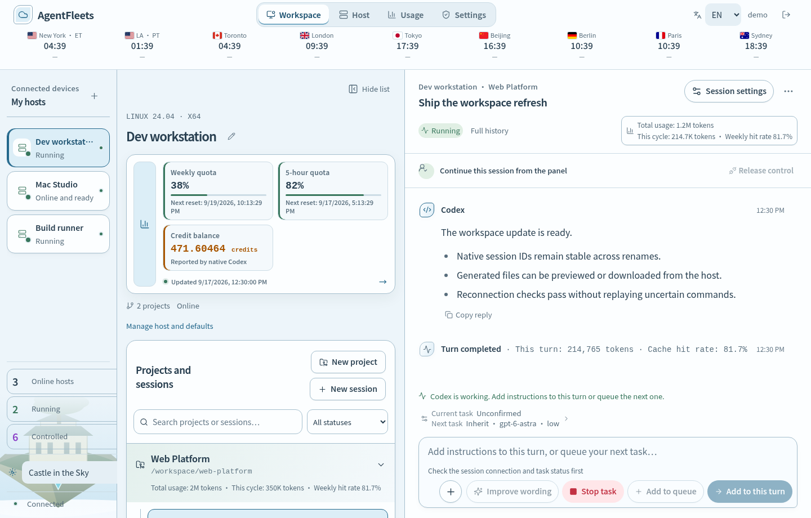
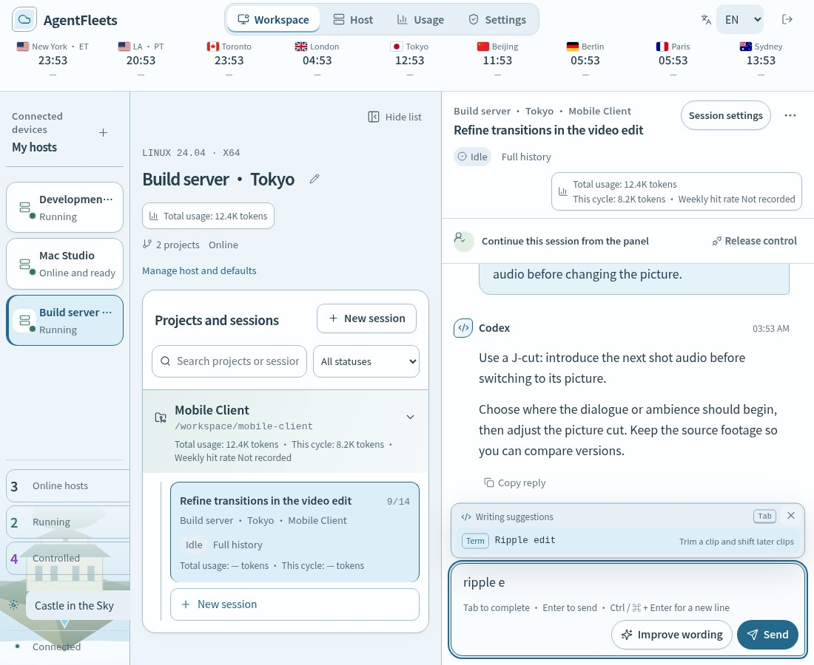
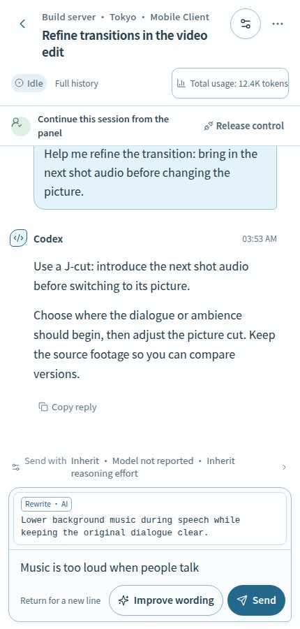
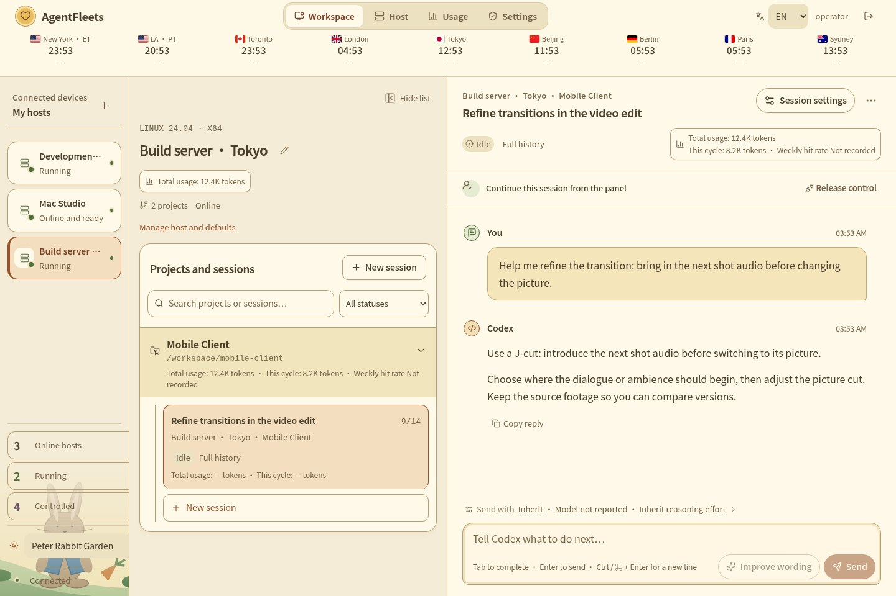
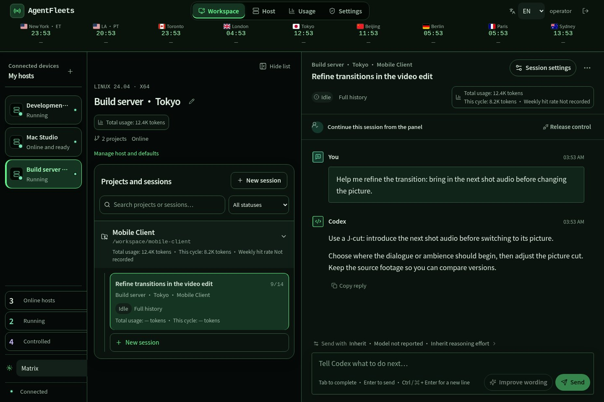

<p align="center">
  
</p>

<p align="center">
  <a href="https://github.com/JosephJagger/AgentFleet/actions/workflows/ci.yml"></a>
  <a href="LICENSE"></a>
  <a href="https://www.npmjs.com/package/agentfleets"></a>
</p>

<p align="center">
  English · <a href="README.zh-CN.md">简体中文</a><br><br>
  <a href="https://www.agentfleets.cn">Open AgentFleets</a> · <a href="#get-started">Installation</a> · <a href="#features">Features</a> · <a href="#self-host">Self-host</a> · <a href="#faq">FAQ</a>
</p>

<p align="center"><strong>One browser workspace for AI work across your computers.</strong><br>
Continue your AI agent conversations, delegate work by voice,<br>
and follow projects running on Linux, macOS and Windows.</p>



<p align="center"><sub>Product screenshots use fictional demo data. Some screenshots show an earlier interface.</sub></p>

## Get started

You can use the **[hosted panel for free](https://www.agentfleets.cn)** or [deploy your own panel](#self-host). Install the host connection service on each computer where you want AI tasks to run. The computer opening the webpage can be a different machine, or a phone.

### 1. Prepare the computer you want to connect

| Host system | Supported architecture | Where to run installation commands |
| --- | --- | --- |
| Windows | x64 | PowerShell, including the PowerShell tab in Windows Terminal |
| macOS | Apple Silicon and Intel | Terminal |
| Linux | x64 | Terminal, or an SSH session on the target server |

Use the same operating-system account that owns your projects and is signed in to Codex or Claude Code. To use Claude Code, install and sign in to its CLI on that host. AgentFleets uses your existing tool accounts and quota; the panel does not include model credits.

**Choose either installation method below.** Direct installation does not require Node.js or npm. The npm method requires **Node.js 22 or newer**.

### 2A. Direct installation — copy a command from the panel

1. Sign in to the panel with your email verification code.
2. Choose **Add host**, select Windows, macOS or Linux, and keep **Direct installation** selected.
3. Copy the generated command and run it on the **host you want to connect**, using the account prepared above. On Windows, use PowerShell, not CMD.
4. Return to the panel and wait for the host to appear online.

The command includes a short-lived connection ticket. Copy it from your own panel; do not share it. The installation sets up the background connection service, so you do not need to keep the installer terminal open.

### 2B. npm installation — install, then connect

Install the public **[agentfleets](https://www.npmjs.com/package/agentfleets)** package on the target host:

```sh
npm install -g agentfleets
```

In the hosted panel, choose **Add host → npm installation** and copy its connection command. It has this form:

```sh
agentfleets connect --url https://panel.example.com --ticket 'YOUR_ONE_TIME_TICKET'
```

Replace the example URL and ticket with those from your own panel. Run the command on the target host, then return to the panel to check that it is online. Installing the npm package alone does not connect a computer.

Prefer not to install a global package? Use the same connection details with:

```sh
npx agentfleets@latest connect --url https://panel.example.com --ticket 'YOUR_ONE_TIME_TICKET'
```

You can also omit `--ticket` to use the browser confirmation flow, including with a self-hosted panel:

```sh
agentfleets connect --url https://panel.example.com
```

Run `agentfleets status` to inspect the local installation and service status. Host Agent updates remain in the panel; `npm update -g agentfleets` updates only the npm installation tool. Existing managed installations are preserved rather than automatically reconnected or replaced. For a broken or partial installation, use the repair instructions on the host page.

### 3. Open a project and start working

1. Select the connected host and choose **Codex** or **Claude Code**, where installed.
2. Open an existing project/session, or create a new one.
3. Take control of the session and send a message. Follow the reply, respond to questions and approvals, and collect the result.

Release control before continuing the same conversation in the host's terminal. When returning to the panel, close the terminal's active session first. This keeps two clients from writing to the same conversation at once.

## Features

### One place for hosts, projects and conversations

Find your work by host, project and AI tool. **Running** helps you follow active work; **Controlled** helps you return to sessions whose results you want to review or continue. Continue the original Codex or Claude Code conversation instead of starting over with a copied prompt.

The browser can manage a headless Linux server just as it manages a desktop computer. After enrollment, routine conversation work does not require opening SSH for each host.

### Delegate work by voice

Open **Voice coordination**, select a compatible Codex voice host, and describe the host, project and task you have in mind. For example:

> “Check the API project's tests on the Linux server, then update the website navigation on the Mac. Tell me how each task is going.”

Different projects can run in parallel, including supported Codex and Claude Code target sessions. View progress, jump to the target conversation, and return to saved to-dos and results after a call. Work in the same project or session still follows its conflict and queue rules.

Voice is experimental and requires HTTPS, microphone permission and a compatible Codex runtime on the voice host. Saved records do not automatically restart tasks. Explicit long-term preferences can be reviewed and edited in Settings. [Voice guide](docs/panel-voice-status.md)

### Keep conversations moving

- **Continue or queue:** send a follow-up, add instructions to a supported running turn, or queue the next message.
- **Plan before acting:** use supported Plan mode and answer the agent's questions in the panel.
- **Keep settings close:** choose models, reasoning effort and permissions from the options reported by the host; reuse defaults and override individual conversations.
- **Bring more context:** reference another conversation, attach screenshots, or choose available skills and plugins.
- **Follow the work:** inspect available execution progress and intermediate messages alongside the conversation.

Available controls differ between Codex, Claude Code and runtime versions. [Claude Code guide](docs/claude-code.md) · [Session navigation](docs/host-session-navigation.md)

### Send files in, get finished files back

Paste a screenshot, upload supported documents or source files, or send a folder while keeping its structure. Ask the agent to investigate a page, organize material, review a spreadsheet or produce a report. Supported file links in replies can be previewed or downloaded from the host.

The upload menu shows size and format limits. Supported inputs include common text/source formats, PDF and macro-free XLSX; it is not an unrestricted file-transfer service. [File delivery](docs/file-delivery.md)

### Schedule recurring work

Create a one-off or recurring prompt for a project: daily checks, weekday summaries, or work at a chosen interval. Select a time zone and review the results in scheduled-task history. Offline hosts or busy projects can delay a run; uncertain outcomes are shown for review rather than blindly repeated.

### Write clearer requests

Chinese and English terminology suggestions help you find a word as you type. **Improve wording** offers a draft you can review before sending. Local suggestions work without an external AI account; optional AI rewriting uses the provider configured in Settings.

| Find a term | Refine a request |
| --- | --- |
|  |  |

### See usage and maintain your hosts

See reported account quota, reset times, project/session token usage and available cache statistics. Missing or stale data is labeled. Host tools also provide updates, connection repair, attachment cleanup and version management.

Optional reset forecasts are estimates, not changes to your account allowance. The native account report remains authoritative. [Usage guide](docs/usage.md) · [Host updates](docs/managed-runtime-updates.md)

### A workspace for daily use and live demonstrations

Choose from **19 themes**, including light, dark, illustrated and Chinese-inspired designs. The interface supports English and Chinese and adapts to desktop and mobile screens.

The **Buzhoushan desktop theme** adds a livestream-oriented workspace: focus mode, a 16:9 presentation canvas, side introductions, compact host switching, and separate **Execution process** and **Human–AI dialogue** views.

For your own Douyin broadcast, its **Interaction messages** window can connect to a separately installed local collector on the computer opening the webpage. Supported chat and independent viewer-entry events can be displayed; automatic welcomes additionally require an active voice coordinator. This is an experimental, unofficial integration whose available events depend on the collector. The panel does not install the collector, and connecting it alone does not guarantee that chat or entry events are available. [Integration requirements](docs/live-interactions.md)

[Theme screenshot gallery](docs/themes.md)

| Peter Rabbit Garden | The Matrix |
| --- | --- |
|  |  |

## Self-host

Self-hosting runs the web panel on your server. You still connect each execution host using one of the installation methods above.

**Prepare:** a Linux server with Git, Docker and Docker Compose; an HTTPS domain/reverse proxy; and a Resend account with a verified sending domain for email sign-in. The server needs internet access to download build dependencies and runtime packages.

### 1. Download and configure

```sh
git clone https://github.com/JosephJagger/AgentFleet.git
cd AgentFleet
cp .env.example .env
```

Edit `.env`. At minimum, set your own values for:

| Setting | What to enter |
| --- | --- |
| `ADMIN_EMAIL` | Your administrator email address |
| `PUBLIC_ORIGIN`, `ALLOWED_ORIGINS` | The same panel URL, such as `https://panel.example.com`, with no path or trailing slash |
| `DJANGO_AUTH_SERVICE_TOKEN`, `DJANGO_SECRET_KEY` | Two different secrets; run `openssl rand -hex 48` separately for each |
| `RESEND_API_KEY` | Your Resend API key |
| `RESEND_FROM_EMAIL` | A sender on your verified domain |

Keep the template's email-auth settings, `COOKIE_SECURE=true` and `PUBLISH_HOST=127.0.0.1` for this HTTPS setup. Keep `.env` private. [Email sign-in setup](apps/identity/README.md)

### 2. Start the panel for the first time

```sh
docker compose up -d --build
curl --fail http://127.0.0.1:3215/ready
```

The health check should return `"status":"ok"`. Forward your HTTPS domain to `http://127.0.0.1:3215`, with WebSocket support. For Caddy:

```caddyfile
panel.example.com {
    reverse_proxy 127.0.0.1:3215
}
```

Open your domain, sign in, and choose **Add host**. Useful troubleshooting commands:

```sh
docker compose ps
docker compose logs --tail=100 control-plane
```

### 3. Update without interrupting a call

The first-start command above is not the update procedure for a live panel. For updates, build a separate image and follow the [voice-safe deployment guide](docs/voice-safe-deployment.md), which waits for active calls to finish.

Back up `.env` and the `agentfleet-data`, `agentfleet-identity` and `agentfleet-runtime-releases` volumes. Keep your existing administrator email. Do not use `docker compose down -v` unless you intend to delete stored data. Update host Agents through the panel when required; a web-only update does not require reinstalling every host.

## FAQ

**Does npm install the whole web panel?**

No. `agentfleets` installs the connection tool for an execution host. Use the hosted panel or Docker Compose for the web panel.

**Which computer runs the task?**

The selected connected host. Your browser computer can be different. Live interaction collection and microphone/speaker settings refer to the computer opening the webpage.

**Can I use only Claude Code?**

Claude Code sessions are supported on hosts where its CLI is installed and authenticated. Voice coordination itself currently needs a compatible Codex voice host; providers do not have identical feature coverage.

**Do I need an inbound port on every host?**

No. The host service connects outward to the panel. The panel itself must be reachable from those hosts.

**Will refreshing the page keep a voice call alive?**

No. A refresh ends the browser's existing call. Where available, use **Restore voice** to establish a new call. Already dispatched project tasks continue on their hosts.

**What are transcript drafts for?**

They help recover the last received words around a voice interruption or call end. They may be incomplete or already handled and are retained for seven days. Reviewing and saving a draft only creates a to-do; execution still requires an explicit instruction.

**Where is my data?**

Tasks and tool authentication stay on your hosts. The panel also stores synchronized conversation content, uploaded attachments and task records; protect its database and backups. Each signed-in user has a private workspace. [Administration](docs/administration.md) · [Security](SECURITY.md)

## Documentation and contribution

[Usage](docs/usage.md) · [Claude Code](docs/claude-code.md) · [Voice preferences](docs/voice-long-term-preferences.md) · [Themes](docs/themes.md) · [Contributing](CONTRIBUTING.md) · [Security reporting](SECURITY.md)

<details>
<summary>Development setup</summary>

Use Node.js 24:

```sh
npm ci --prefix apps/control-plane
npm ci --prefix apps/local-agent
npm ci --prefix apps/web
npm run check
npm test
npm run build
```

See [packaging](packaging/README.md) for release tooling.

</details>

---

[MIT license](LICENSE) · [Third-party notices](THIRD_PARTY_NOTICES.md)

Independent project, not an official OpenAI or Anthropic product. Bring your own tool accounts and available quota.
