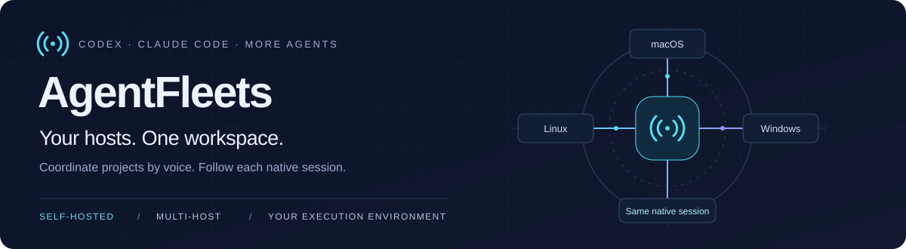
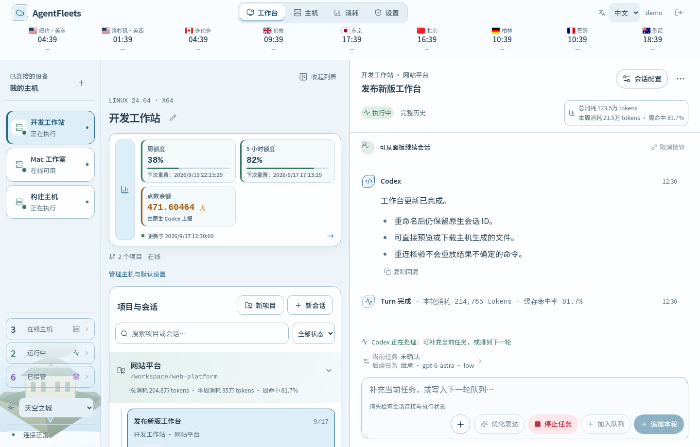
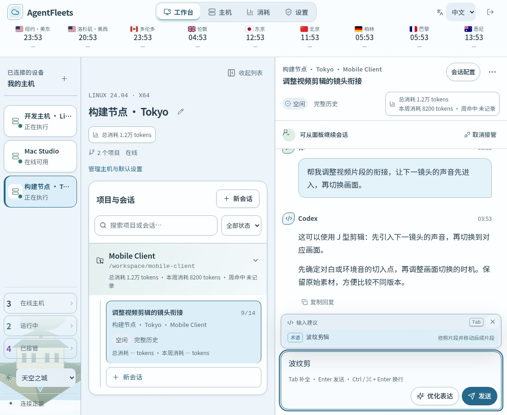
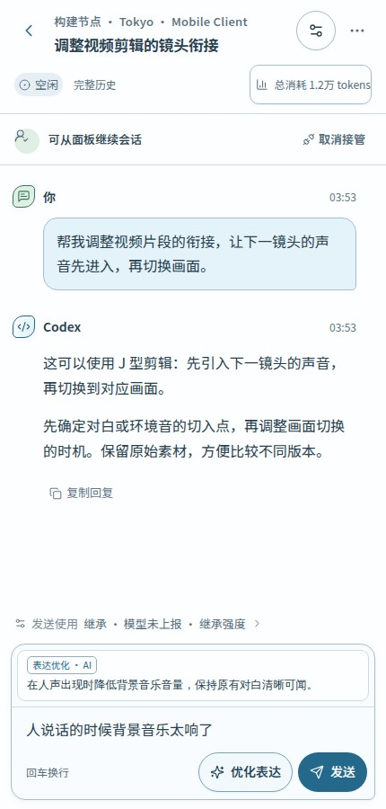
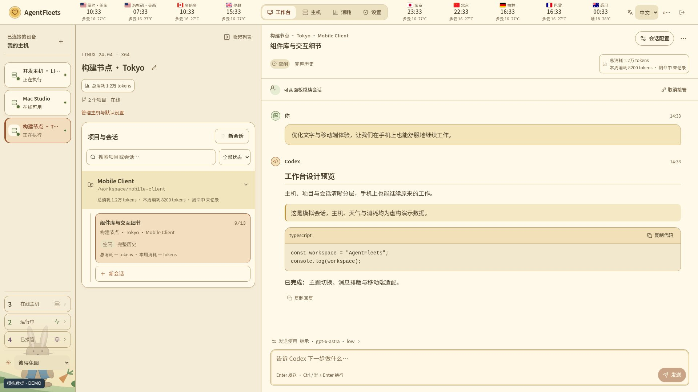
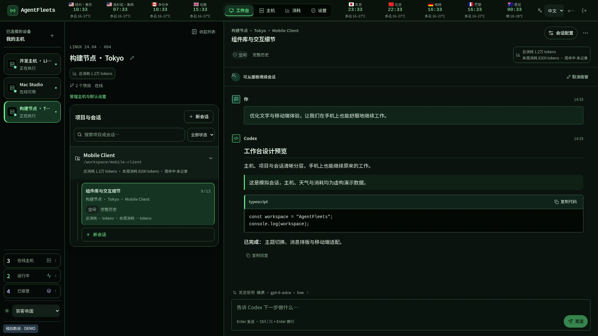

<p align="center">
  
</p>

<p align="center">
  <a href="https://github.com/JosephJagger/AgentFleet/actions/workflows/ci.yml"></a>
  <a href="LICENSE"></a>
  <a href="https://www.npmjs.com/package/agentfleets"></a>
</p>

<p align="center">
  <a href="README.md">English</a> · 简体中文<br><br>
  <a href="https://www.agentfleets.cn">打开 AgentFleets</a> · <a href="#快速安装">安装教程</a> · <a href="#特色功能">特色功能</a> · <a href="#自行部署">自行部署</a> · <a href="#常见问题">常见问题</a>
</p>

<p align="center"><strong>一个网页工作台，管理多台电脑上的 AI 工作。</strong><br>
继续各个 AI 智能体的会话，用语音派发任务，<br>
随时查看 Linux、macOS 和 Windows 上各个项目的进度。</p>



<p align="center"><sub>截图使用虚构演示数据；部分截图来自较早的界面版本。</sub></p>

## 快速安装

可以直接使用 **[免费在线面板](https://www.agentfleets.cn)**，也可以[自行部署面板](#自行部署)。在每台需要执行 AI 任务的电脑上安装主机连接服务即可。打开网页的电脑可以是另一台电脑，也可以换成手机。

### 第一步：准备要连接的电脑

| 主机系统 | 支持架构 | 在哪里执行安装命令 |
| --- | --- | --- |
| Windows | x64 | PowerShell，或 Windows 终端中的 PowerShell 标签页 |
| macOS | Apple Silicon、Intel | “终端”应用 |
| Linux | x64 | 本机终端，或 SSH 登录目标服务器后的终端 |

请使用拥有项目、并已登录 Codex 或 Claude Code 的同一个操作系统账号。使用 Claude Code 时，需要在该主机安装并登录其 CLI。AgentFleets 沿用你已有的工具账号和额度，面板不提供模型点数。

**下面两种安装方式选一种即可。** 直接安装不要求预装 Node.js 或 npm；npm 安装需要 **Node.js 22 或更高版本**。

### 第二步 A：直接安装——从面板复制命令

1. 用邮箱验证码登录面板。
2. 点击 **“添加主机”**，选择 Windows、macOS 或 Linux，保持 **“直接安装”** 选中。
3. 复制生成的命令，在**要连接的那台主机**上，用第一步准备好的账号运行。Windows 请使用 PowerShell，不要使用 CMD。
4. 返回面板，等待主机显示在线。

命令包含短期有效的连接票据，请从自己的面板复制，不要转发。安装完成后，连接服务在后台运行，不需要一直开着安装终端。

### 第二步 B：npm 安装——先安装，再连接

在要连接的主机上安装公开的 **[agentfleets](https://www.npmjs.com/package/agentfleets)** 包：

```sh
npm install -g agentfleets
```

在在线面板中选择 **“添加主机 → npm 安装”**，复制连接命令。命令形式如下：

```sh
agentfleets connect --url https://panel.example.com --ticket 'YOUR_ONE_TIME_TICKET'
```

示例地址和票据需要换成自己面板提供的内容。运行后返回面板，确认主机在线。只完成 npm 包安装，还没有完成主机连接。

不想全局安装，也可以使用相同的连接信息，通过 npx 运行：

```sh
npx agentfleets@latest connect --url https://panel.example.com --ticket 'YOUR_ONE_TIME_TICKET'
```

也可以省略 `--ticket`，按终端提示在浏览器确认连接，自行部署的面板同样适用：

```sh
agentfleets connect --url https://panel.example.com
```

运行 `agentfleets status` 可检查本机安装和服务状态。后续 **Agent 更新仍在面板完成**；`npm update -g agentfleets` 只更新 npm 安装工具。检测到已有托管安装时会保留原连接，不会自动重新配对或覆盖。安装损坏或中途失败时，请使用主机页面提供的修复说明。

### 第三步：打开项目，开始工作

1. 选择在线主机，按安装情况切换 **Codex** 或 **Claude Code**。
2. 打开已有项目和会话，也可以新建。
3. 接管会话并发送消息，查看回复、回答问题或确认审批，最后收取结果。

要回到主机终端继续同一个会话，请先在面板取消接管。要从终端返回面板，请先退出终端中正在使用的会话，避免两边同时操作同一段对话。

## 特色功能

### 多主机、多项目、多个 AI 工具，集中管理

按主机、项目和 AI 工具找到工作。**“正在运行”**用于查看执行中的任务；**“已接管”**用于回到仍由面板控制的会话，查看结果或继续追问。继续的是原来的 Codex 或 Claude Code 会话，无需另起对话重新交代背景。

没有图形桌面的 Linux 服务器也能使用。完成连接后，日常对话管理可以直接在浏览器进行，不必逐台打开 SSH。

### 用语音总控派发任务

打开 **“语音总控”**，选择支持语音的 Codex 主机，然后说清主机、项目和任务。例如：

> “检查 Linux 服务器上 API 项目的测试，再修改 Mac 上网站项目的导航，分别告诉我进度。”

不同项目可以并行推进，目标可以是受支持的 Codex 或 Claude Code 会话。随时查询进度、打开对应会话，挂断后也能回看已保存的待办与结果。同一项目或会话仍遵循冲突保护和排队规则。

语音属于实验功能，需要 HTTPS、麦克风权限和兼容的 Codex 语音运行环境。恢复记录不会自动重新执行任务；明确保存的长期偏好可在设置中查看和修改。[语音功能说明](docs/panel-voice-status.md)

### 对话、计划、追加与排队

- **继续或排队：** 继续追问，向支持的运行中轮次补充指令，或将消息排到下一轮。
- **先计划再执行：** 使用支持的计划模式，在面板直接回答 AI 的问题。
- **配置随手调整：** 从主机提供的选项中选择模型、思考强度和权限，复用默认配置，也可为单个会话调整。
- **带上更多上下文：** 引用其他会话、附加截图，或选用可用的技能与插件。
- **查看执行过程：** 在对话旁查看可获取的执行进度和中途消息。

Codex、Claude Code 和不同运行版本的可用选项有所区别。[Claude Code 使用说明](docs/claude-code.md) · [会话导航](docs/host-session-navigation.md)

### 把资料交给 AI，再把成果带回来

粘贴截图、上传支持的文档或代码文件，也可以保留目录结构上传文件夹。让 AI 排查页面问题、整理资料、检查表格或生成报告。回复中支持的文件链接可以直接从主机预览或下载。

上传菜单会说明格式和大小限制。支持常见文本／代码、PDF、无宏 XLSX 等文件，并非任意格式的通用文件传输工具。[文件交付说明](docs/file-delivery.md)

### 定时执行重复工作

为项目设置一次性任务、每日任务、工作日任务或固定间隔任务。例如定时检查、日报整理和周期性资料处理。可以选择时区，并在定时任务历史中查看结果。主机离线或项目忙碌时可能延迟执行；结果无法确认的任务会提示核查，不会盲目重跑。

### 不懂术语，也能表达清楚

中英文术语补全帮助你边写边找到合适的词。**“优化表达”**会给出可供检查的改写，再由你决定是否发送。本地建议无需额外 AI 账号；可选的 AI 改写使用设置中配置的服务。

| 找到合适的术语 | 把请求表达清楚 |
| --- | --- |
|  |  |

### 查看额度消耗，维护连接主机

查看主机报告的账号额度、重置时间、项目与会话 token 消耗，以及可用的缓存统计。缺失或过期的数据会明确标注。主机工具还提供更新、连接修复、附件清理和版本管理。

可选的重置预测仅供参考，不会改变账号额度，实际情况以原生账号报告为准。[用量说明](docs/usage.md) · [主机更新](docs/managed-runtime-updates.md)

### 日常工作与直播演示，各有合适的界面

提供 **19 种主题**，覆盖明暗配色、插画和中国风设计；支持中英文界面，适配电脑和手机。

**不周山主题面向桌面直播**，提供直播聚焦、16:9 演示画布、两侧直播介绍、紧凑主机切换，以及独立的 **“执行过程”** 和 **“人机对话”** 区域。

自己在抖音开播时，可从 **“互动消息”** 窗口连接安装在**打开网页这台电脑**上的独立采集器，展示其支持的聊天和独立入场消息。自动欢迎还需要连接语音总控。这是实验性的非官方接入，实际可用消息取决于采集器；面板不会代装采集器，显示已连接也不代表一定能收到聊天或入场事件。[接入条件与限制](docs/live-interactions.md)

[主题截图画廊](docs/themes.zh-CN.md)

| 彼得兔园 | 黑客帝国 |
| --- | --- |
|  |  |

## 自行部署

自行部署是在你的服务器上运行网页面板；执行任务的每台电脑仍需按前面的步骤安装主机连接服务。

**需要准备：** 一台安装 Git、Docker 和 Docker Compose 的 Linux 服务器，一个支持 HTTPS 的域名／反向代理，以及用于邮箱登录的 Resend 账号和已验证发信域名。服务器需要联网下载构建依赖和运行包。

### 1. 下载并配置

```sh
git clone https://github.com/JosephJagger/AgentFleet.git
cd AgentFleet
cp .env.example .env
```

编辑 `.env`，至少填好：

| 配置项 | 填写内容 |
| --- | --- |
| `ADMIN_EMAIL` | 管理员邮箱 |
| `PUBLIC_ORIGIN`、`ALLOWED_ORIGINS` | 填写同一个面板地址，例如 `https://panel.example.com`，不带路径和末尾斜杠 |
| `DJANGO_AUTH_SERVICE_TOKEN`、`DJANGO_SECRET_KEY` | 两个不同的密钥，分别运行一次 `openssl rand -hex 48` 生成 |
| `RESEND_API_KEY` | Resend API 密钥 |
| `RESEND_FROM_EMAIL` | 已验证域名下的发信地址 |

此 HTTPS 方案保留模板中的邮箱认证配置、`COOKIE_SECURE=true` 和 `PUBLISH_HOST=127.0.0.1`。不要公开 `.env`。[邮箱登录配置说明](apps/identity/README.md)

### 2. 首次启动面板

```sh
docker compose up -d --build
curl --fail http://127.0.0.1:3215/ready
```

健康检查应返回 `"status":"ok"`。将 HTTPS 域名反向代理到 `http://127.0.0.1:3215`，并启用 WebSocket 支持。例如 Caddy：

```caddyfile
panel.example.com {
    reverse_proxy 127.0.0.1:3215
}
```

打开自己的域名，登录后点击 **“添加主机”**。排查启动问题时可查看：

```sh
docker compose ps
docker compose logs --tail=100 control-plane
```

### 3. 后续更新，保护正在进行的通话

上面的首次启动命令不适合直接用于正在通话的面板升级。后续先构建独立镜像，再按[通话安全发布流程](docs/voice-safe-deployment.md)更新，等待已有通话结束后切换。

更新前备份 `.env` 和 `agentfleet-data`、`agentfleet-identity`、`agentfleet-runtime-releases` 三个数据卷，保留原来的管理员邮箱。除非确定要删除数据，否则不要运行 `docker compose down -v`。需要升级主机 Agent 时使用面板更新；仅更新网页不需要逐台重装主机。

## 常见问题

**npm 安装的是整个网页面板吗？**

不是。`agentfleets` 提供执行主机的连接工具；网页面板使用在线服务，或通过 Docker Compose 自行部署。

**任务究竟在哪台电脑执行？**

在你选中的已连接主机执行，打开网页的电脑可以是另一台。直播互动采集、麦克风和扬声器设置则对应打开网页的本机。

**只用 Claude Code 可以吗？**

可以管理已安装、已登录 Claude Code 的主机会话。语音总控本身目前仍需要兼容的 Codex 语音主机，两种工具的功能范围并不完全相同。

**每台主机都要开放端口吗？**

不需要。连接服务主动向面板建立连接，只需保证主机能够访问面板地址。

**刷新网页后，语音通话会保留吗？**

不会保留原通话。刷新会结束当前浏览器通话；提供恢复入口时，可点击“恢复语音”建立新通话。已经派发的项目任务仍在对应主机执行。

**“待确认转写”有什么用？**

用于找回语音中断或结束前已收到的最后一段话，可能不完整，也可能已经处理，保留 7 天。核对保存只创建待办，仍需明确下达执行指令。

**数据保存在哪里？**

任务执行与工具认证保留在主机；面板也会保存同步的对话正文、上传附件和任务记录，需要保护数据库与备份。每个登录用户有独立工作区。[账号管理](docs/administration.md) · [安全说明](SECURITY.md)

## 文档与参与贡献

[用量说明](docs/usage.md) · [Claude Code](docs/claude-code.md) · [语音长期偏好](docs/voice-long-term-preferences.md) · [主题画廊](docs/themes.zh-CN.md) · [参与贡献](CONTRIBUTING.md) · [安全报告](SECURITY.md)

<details>
<summary>开发环境</summary>

使用 Node.js 24：

```sh
npm ci --prefix apps/control-plane
npm ci --prefix apps/local-agent
npm ci --prefix apps/web
npm run check
npm test
npm run build
```

发布工具见 [packaging](packaging/README.md)。

</details>

---

[MIT 许可证](LICENSE) · [第三方声明](THIRD_PARTY_NOTICES.md)

本项目独立开发，非 OpenAI 或 Anthropic 官方产品。请自行准备工具账号及可用额度。
